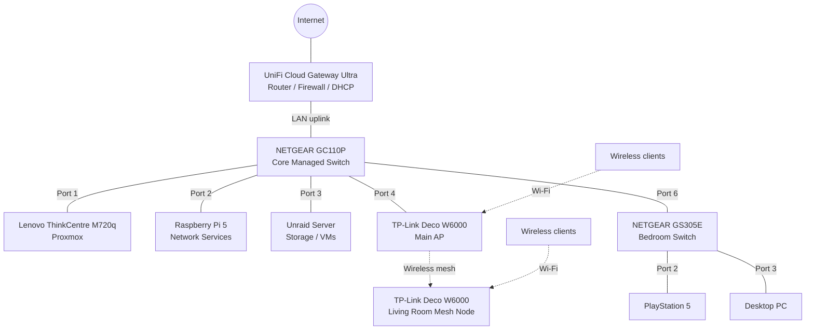

# Physical Network Topology

## Overview

The current physical layout is centered on the UniFi Cloud Gateway Ultra and NETGEAR GC110P managed switch. The diagram below represents the **current physical connections**, not the proposed VLAN design.

## Current physical topology

**Important port detail:** The UniFi gateway uplink connects to GC110P physical port 5. The diagram shows the gateway-to-core-switch link; the switch-side connection is port 5.

## Main switch: NETGEAR GC110P

| Physical port | Connected device | Current role |
|---:|---|---|
| 1 | Lenovo ThinkCentre M720q (Proxmox) | Server connection |
| 2 | Raspberry Pi 5 | Services and network utilities |
| 3 | Unraid server | Storage and virtualization |
| 4 | Main TP-Link Deco W6000 | Wireless access point |
| 5 | UniFi Cloud Gateway Ultra | Gateway uplink |
| 6 | NETGEAR GS305E | Bedroom switch uplink |
| 7–8 | Unused | Available |

The switch UI labels ports using its interface naming convention (for example, g1–g10). This document uses the physical copper port numbers.

## Bedroom switch: NETGEAR GS305E

| Physical port | Connected device |
|---:|---|
| 1 | Uplink to GC110P physical port 6 |
| 2 | PlayStation 5 |
| 3 | Desktop PC |
| 4–5 | Unused |

## Wireless

- Main Deco W6000: wired to GC110P physical port 4.
- Living room Deco W6000: wireless mesh connection to the main Deco.
- The Deco units operate in Access Point mode.
- SSIDs currently include the primary, guest, and IoT wireless networks.
- Per-SSID VLAN tagging has not been verified; these SSIDs are not mapped to proposed VLANs in this design.

## Current-state caveats

- The gateway uplink is connected to GC110P physical port 5.
- GC110P physical port 6 and GS305E port 1 currently carry the default network as untagged VLAN 1.
- The GS305E currently has VLAN 1 as the only configured VLAN, with all five ports members and PVID 1.
- The GC110P has VLAN 1 and the factory Auto-Video VLAN 4089 entry. Auto-Video is disabled and is not part of the proposed segmentation.
- No additional VLANs have been created.
- The current wired and wireless network is a single LAN; the topology does not imply separate VLANs for the wireless SSIDs.

## Diagram maintenance

Update this document whenever a physical cable, switch port, or device role changes. Keep a dated note in the changelog for material topology changes.
