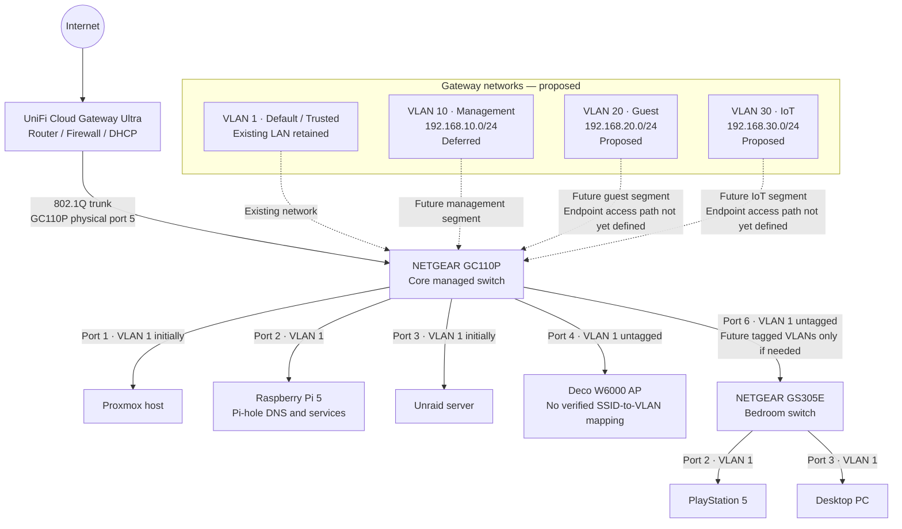

# Proposed Logical VLAN Architecture

**Status: Proposed — not deployed**

This diagram represents the intended logical segmentation model. It is separate from the [current physical topology](physical-topology.md) and must not be interpreted as a description of live VLAN configuration.

## Proposed logical architecture

## VLAN design summary

| VLAN | Name | Subnet | Gateway (proposed) | Status |
|---:|---|---|---|---|
| 1 | Default / Trusted | Existing LAN | Existing gateway | Current |
| 10 | Management | 192.168.10.0/24 | 192.168.10.1 | Deferred |
| 20 | Guest | 192.168.20.0/24 | 192.168.20.1 | Proposed |
| 30 | IoT | 192.168.30.0/24 | 192.168.30.1 | Proposed |

## Intended traffic policy

- **VLAN 1 — Default / Trusted:** preserve existing connectivity during initial rollout.
- **VLAN 10 — Management:** defer migration of infrastructure management interfaces until the other segments are stable and a controlled migration plan exists.
- **VLAN 20 — Guest:** allow internet access; block access to trusted devices and management interfaces.
- **VLAN 30 — IoT:** allow only required internet and local-service access; deny unsolicited access to trusted devices by default.
- **DNS:** if Pi-hole remains on VLAN 1, permit required DNS requests from approved client VLANs to the Pi-hole service. Define and test any additional service exceptions before deployment.

These are policy objectives, not configured firewall rules.

## Important implementation constraints

1. **No new VLANs are currently deployed.** VLANs 10, 20, and 30 are design proposals only.
2. **Gateway-to-switch trunk:** the GC110P physical port 5 connects to the UniFi gateway. Any future tagged VLANs must be configured consistently at both ends while preserving the existing VLAN 1 connectivity.
3. **Bedroom-switch uplink:** GC110P physical port 6 connects to GS305E port 1. Both currently carry VLAN 1 untagged. Tagged VLANs would require matching membership and PVID decisions on both switches.
4. **Wireless limitation:** the Deco W6000 is operating in Access Point mode. Per-SSID 802.1Q VLAN mapping has not been verified in its manual or app. Its guest and IoT SSIDs must not be represented as VLAN 20 or VLAN 30.
5. **Endpoint placement:** the current PC and PS5 remain on VLAN 1. No access ports or wireless SSIDs have yet been assigned to VLAN 20 or VLAN 30.
6. **Server ports:** Proxmox, Raspberry Pi, and Unraid remain on the existing network initially. Do not make a server port a trunk until its host networking and guest requirements are documented.

## Before deployment

- Confirm VLAN interface, DHCP, and firewall support on the UniFi gateway.
- Decide how VLAN 20 and VLAN 30 clients will connect, given the current Deco limitation.
- Define DHCP scopes, DNS behavior, and required service exceptions.
- Verify switch tagging, untagged membership, PVID, and ingress-filter behavior.
- Prepare a maintenance window, validation checklist, and rollback plan.
- Implement and test one change at a time.

## Related documentation

- [Current physical topology](physical-topology.md)
- [VLAN design and policy objectives](vlan-design.md)
- [Switch configuration baseline](switch-configuration.md)
- [Router configuration baseline](router-configuration.md)
